# КТ3. CI/CD и GitOps

Выполнил: Ким Тэ Ян

## Задание

Цель: на локальном kind-кластере развернуть рабочий CI/CD-контур на самостоятельно поднятом GitLab, пройти путь от классического пайплайна с прямым деплоем к GitOps-подходу через ArgoCD и на практике увидеть разницу между ними: что происходит при ручном вмешательстве в кластер в каждом из двух случаев.

Все разворачивается в одном локальном kind-кластере:

- GitLab CE (Omnibus, один под): собственные git-репозитории, CI, веб-интерфейс;
- GitLab Runner (Kubernetes executor): исполняет джобы пайплайна как отдельные поды в том же кластере;
- локальный container registry (registry:2): хранит собранные образы;
- ArgoCD (core-install, без UI): GitOps-контроллер, разворачивается во второй части задания.

Часть 1. Классический CI/CD (push-модель). Пайплайн выполняет полный цикл сам, без посредников:

1. Тесты. Если тест падает, дальнейшие шаги не запускаются (gate).
2. Сборка образа через kaniko, без Docker-in-Docker.
3. Push собранного образа в локальный registry.
4. Сам пайплайн выполняет `kubectl set image` в целевом namespace, используя ServiceAccount раннера.

Эксперимент 1. Вручную, в обход пайплайна, поменять образ или конфигурацию прямо в кластере (например, `kubectl set image` на другой тег). Зафиксировать, что ничего не происходит: расхождение остается, пока кто-то не заметит его сам или не перезапустит пайплайн.

Часть 2. GitOps. Желаемое состояние выносится в отдельный config-repo. Пайплайн больше не деплоит сам, он только коммитит новый tag/digest образа в config-repo. ArgoCD следит за репозиторием и применяет изменения самостоятельно.

Эксперимент 2. Повторить то же ручное вмешательство, что и в эксперименте 1. ArgoCD обнаруживает расхождение (OutOfSync) и сам возвращает желаемое состояние (self-healing).

Обязательные требования:

- тесты реально блокируют сборку: один прогон с намеренно сломанным тестом и один с зеленым;
- образ собирается через kaniko, а не локальным `docker build` на хост-машине;
- в части 1 деплой выполняется самим пайплайном; в части 2 пайплайн только коммитит в config-repo, `kubectl apply` нигде вручную не используется;
- оба эксперимента выполняются одинаковым способом вмешательства в кластер;
- отчет явно сравнивает push-модель и pull-модель (GitOps).

Пакет доказательств: лог CI с упавшим и с зеленым тестом, лог сборки kaniko и push в registry, вывод kubectl с образом в кластере после части 1, лог эксперимента 1, diff/коммит в config-repo, статус ArgoCD Application (Synced / Healthy), лог эксперимента 2. По желанию: прогнать syft на своем образе и объяснить, зачем нужен SBOM.

## Стенд

| Компонент | Версия | Где |
|---|---|---|
| kind / Kubernetes | 0.33.0 / 1.37.0 | один узел `kt3-control-plane` |
| GitLab CE | 19.5.3 | namespace `gitlab`, http://localhost:8930 |
| GitLab Runner | 19.5.2 (Helm-чарт 0.94.2) | namespace `ci`, джобы тоже в `ci` |
| registry | 2.8.3 | namespace `registry`, с хоста http://localhost:5030 |
| kaniko | v1.24.0-debug | образ джоба `build` |
| ArgoCD | v3.5.6, core-install | namespace `argocd` |
| syft | v1.56.0 | запускался отдельно в Docker |

Хост: Windows 10, Docker Desktop 29.5.3, скрипты на bash (Git Bash или WSL2).

```text
GitLab (hello-app) ──push──▶ Runner ──▶ поды джобов в ns ci
                                         │ test: python -m unittest
                                         │ build: kaniko ──▶ registry.registry.svc:5000/hello:<sha>
Часть 1:                                 └ deploy: kubectl set image ──▶ ns demo-push
Часть 2:                                 └ update-config: git commit ──▶ GitLab (config-repo)
                                                                              │
                                         ArgoCD (ns argocd) ◀──── опрос ──────┘
                                                └── sync + selfHeal ──▶ ns demo-gitops
```

Приложение `hello`: HTTP-сервис на Python без зависимостей (`app/app.py`), отвечает строкой с версией образа. Тест один: `test_app.py` проверяет функцию `greeting`.

Узел kind не видит DNS кластера, а образы тянет containerd на узле. Поэтому у сервиса registry фиксированный ClusterIP `10.96.50.50`, а на узле лежит `/etc/containerd/certs.d/registry.registry.svc.cluster.local:5000/hosts.toml`, который отправляет это имя на ClusterIP по http. Так kaniko в поде и containerd на узле используют одно и то же имя образа.

## Файлы

| Путь | Что это |
|---|---|
| `app/` | код сервиса, тест, Dockerfile и манифест для части 1 (`deploy/hello.yaml`) |
| `ci/part1-push.gitlab-ci.yml` | `.gitlab-ci.yml` части 1: test, build, deploy |
| `ci/part2-gitops.gitlab-ci.yml` | `.gitlab-ci.yml` части 2: test, build, update-config |
| `config-repo/hello/` | содержимое config-repo: Deployment и Service |
| `argocd/` | AppProject и Application |
| `k8s/` | kind-конфиг, GitLab, registry, RBAC для CI, values раннера |
| `scripts/setup.sh` | подъём стенда по шагам |
| `screenshots/` | скриншоты |

## Как поднять

```bash
export KUBECONFIG=$HOME/.kube/kt3
bash scripts/setup.sh cluster   # kind-кластер и hosts.toml для registry
bash scripts/setup.sh infra     # registry, GitLab, RBAC для CI, ArgoCD core
bash scripts/setup.sh gitlab    # ждёт GitLab (около 5 минут), токен root, проекты hello-app и config-repo
bash scripts/setup.sh runner    # instance runner через API и Helm-чарт раннера
```

Пароль root и токены скрипт генерирует сам и кладёт в `.secrets/`, эта папка в `.gitignore`. Токены выпускаются на 7 дней.

Часть 1: в проект `root/hello-app` пушится содержимое `app/`, а `ci/part1-push.gitlab-ci.yml` кладётся как `.gitlab-ci.yml`.

Часть 2: в `root/config-repo` пушится содержимое `config-repo/` с тегом образа из части 1, затем `bash scripts/setup.sh gitops` создаёт токены и Application. В hello-app `.gitlab-ci.yml` заменяется на `ci/part2-gitops.gitlab-ci.yml`, папка `deploy/` удаляется.

Удаление стенда: `kind delete cluster --name kt3`.

## Инфраструктура

Все компоненты работают в одном кластере: GitLab, раннер, registry, ArgoCD (application-controller, repo-server, redis, applicationset-controller) и приложение части 1.

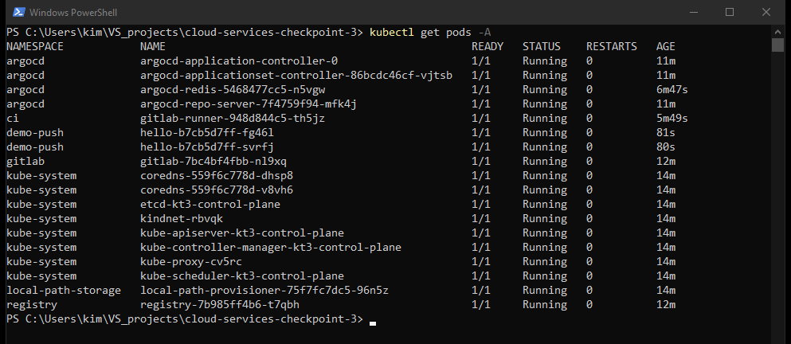

## Часть 1. Push-модель

Пайплайн (`ci/part1-push.gitlab-ci.yml`) состоит из трёх стадий. `test` запускает `python -m unittest` в `python:3.13-alpine`. `build` собирает образ kaniko и пушит его как `registry.registry.svc.cluster.local:5000/hello:$CI_COMMIT_SHORT_SHA`. `deploy` в образе `alpine/kubectl` при первом запуске создаёт Deployment и Service, а дальше делает `kubectl set image` и ждёт `rollout status`.

Джобы раннера работают от ServiceAccount `ci/ci-deployer`. Права у него только в namespace `demo-push` и только на то, что нужно для деплоя: deployments (get, list, watch, create, patch, update), replicasets и pods на чтение, services (get, create, patch). См. `k8s/ci-rbac.yaml`.

Три прогона:

- #1 `477022bd`, первая версия: все стадии зелёные, сервис задеплоен;
- #2 `da49f858`, в `greeting` убрана запятая: тест упал, `build` и `deploy` не запускались;
- #3 `7eedb8d4`, запятая возвращена: всё зелёное, в кластер выкатилась новая версия.

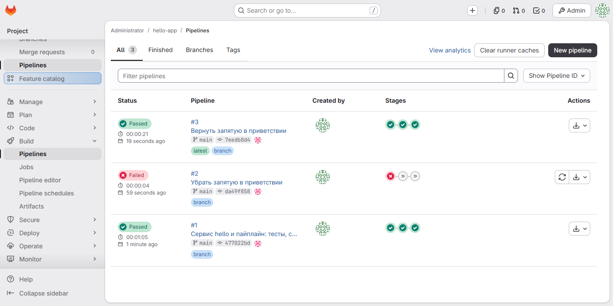

Упавший тест в пайплайне #2. Джоб закончился с кодом 1, следующие стадии пропущены:

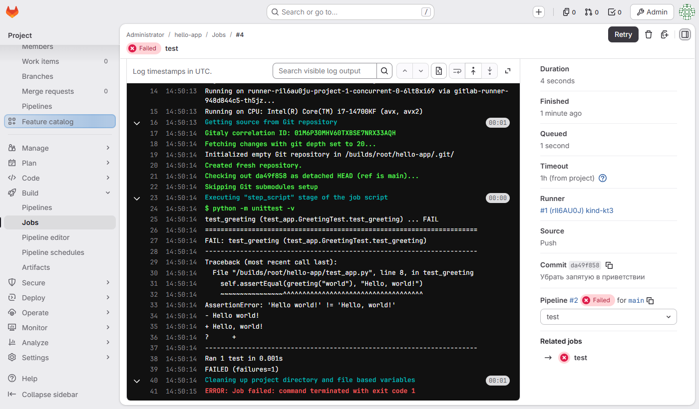

Тот же тест в пайплайне #3:

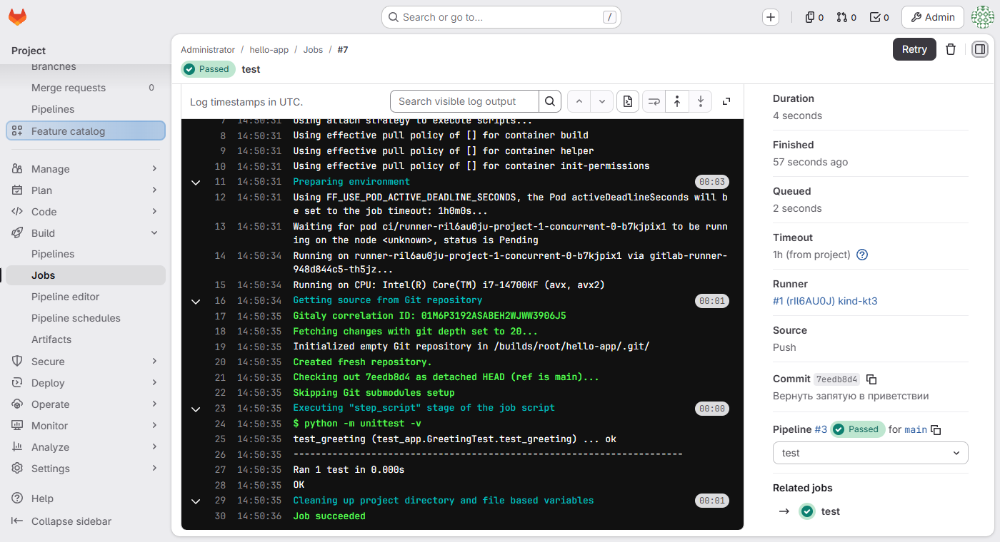

Сборка kaniko. В конце лога push в registry внутри кластера с digest образа:

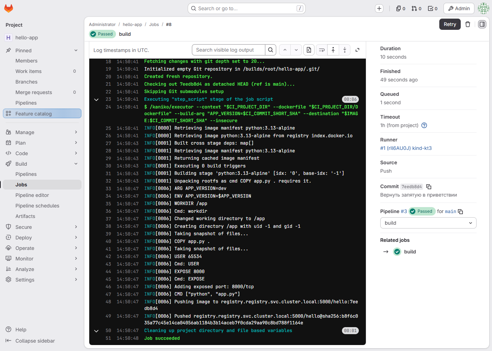

Деплой из пайплайна: `kubectl set image` и `rollout status` выполняет сам джоб:

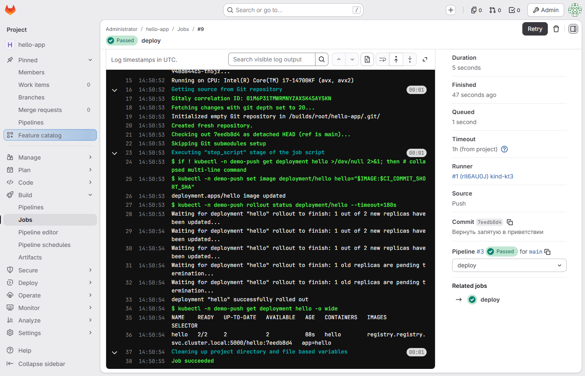

После части 1 в registry два тега, в `demo-push` работает образ `7eedb8d4` из последнего зелёного пайплайна, сервис отвечает этой версией:

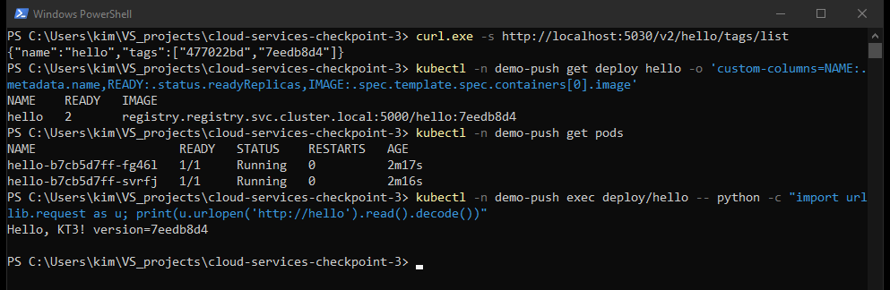

## Эксперимент 1. Ручное изменение при push-модели

В 17:53:39 я вручную вернул в `demo-push` старый образ: `kubectl -n demo-push set image deployment/hello hello=registry.registry.svc.cluster.local:5000/hello:477022bd`. В git и в последнем пайплайне по-прежнему `7eedb8d4`.

Через 5 минут (17:58:36) в кластере всё ещё `477022bd`, сервис отвечает `version=477022bd`:

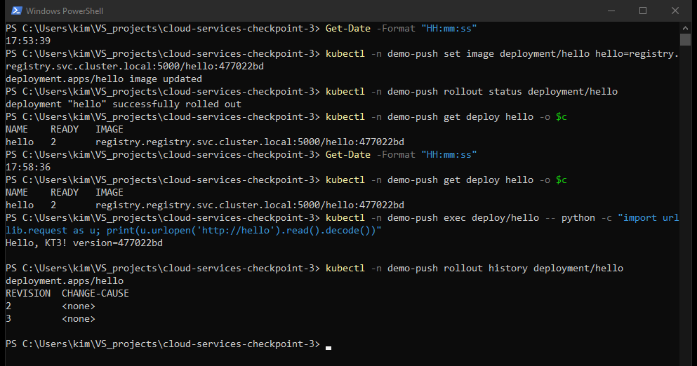

Проверка ещё через 8 минут, в 18:06:21, показала то же самое:

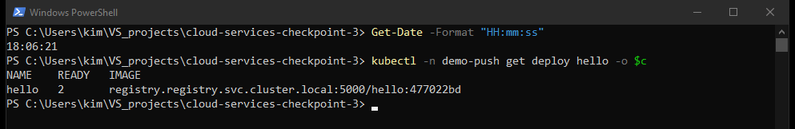

Расхождение никто не заметил. Пайплайн запускается только по push в репозиторий и про состояние кластера не знает, поэтому оно останется, пока кто-нибудь не сделает новый коммит или не перезапустит старый пайплайн руками.

## Часть 2. GitOps

Config-repo (`root/config-repo` в том же GitLab) хранит `hello/deployment.yaml` и `hello/service.yaml`. Первый коммит в него сделан руками, с образом `7eedb8d4` из части 1. Дальше строку с образом меняет только CI.

Пайплайн части 2 (`ci/part2-gitops.gitlab-ci.yml`):

- `test` такой же;
- `build` собирает образ kaniko и пишет в артефакт `image-ref.txt` ссылку вида `hello:<sha коммита>@sha256:<digest>`;
- `update-config` в образе `alpine/git` клонирует config-repo, меняет `image:` и пушит коммит `hello: <sha>`.

Доступа к кластеру у пайплайна нет: джоба `deploy` больше нет, а в config-repo CI пишет project access token с ролью Maintainer и единственным scope `write_repository`. Токен лежит в masked-переменной `CONFIG_REPO_TOKEN`. ArgoCD читает config-repo другим токеном, Reporter с `read_repository`.

Application `hello` (`argocd/application.yaml`) смотрит на ветку `main`, путь `hello`, и ставит всё в `demo-gitops` с `automated: {prune: true, selfHeal: true}`. В core-install нет argocd-server, поэтому проекта `default` там нет. Я сделал свой AppProject `kt3`, который пускает только config-repo и только namespace `demo-gitops`. Интервал опроса git уменьшен до 60 секунд (`timeout.reconciliation` в `argocd-cm`).

Ручной `kubectl apply` в части 2 для приложения не использовался. `setup.sh gitops` применяет только объекты самого ArgoCD: AppProject, Application и секрет с доступом к репозиторию. Deployment и Service в `demo-gitops` создал ArgoCD из config-repo.

Пайплайны #5 и #6 прошли по новой схеме. #6 добавил в ссылку на образ тег коммита (см. «Что пошло не так»):

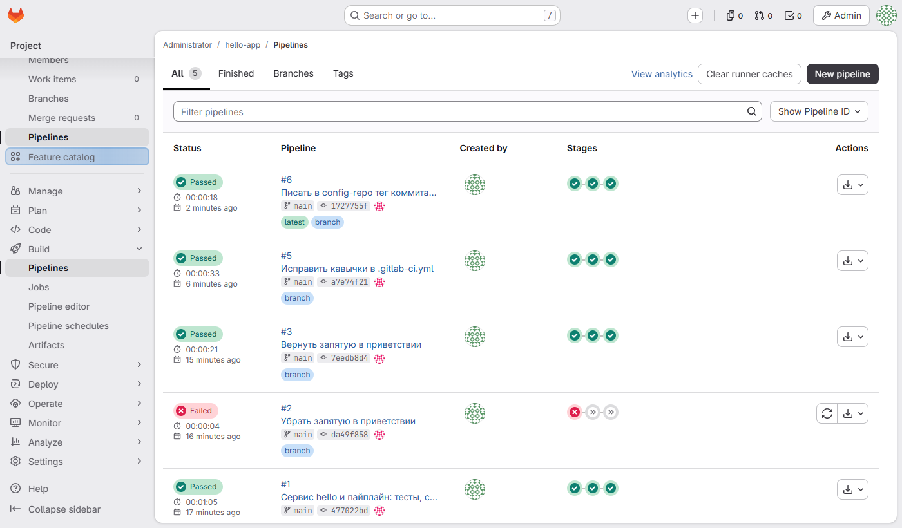

Джоб `update-config`: коммит в config-repo и push. Строку с токеном джоба, которую GitLab пишет при скачивании артефакта, я закрасил на скриншоте:

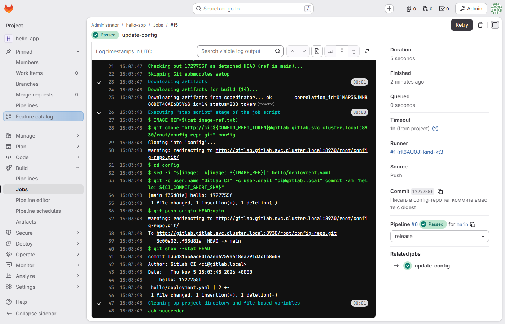

Коммит CI в config-repo, diff одной строки `image:`:

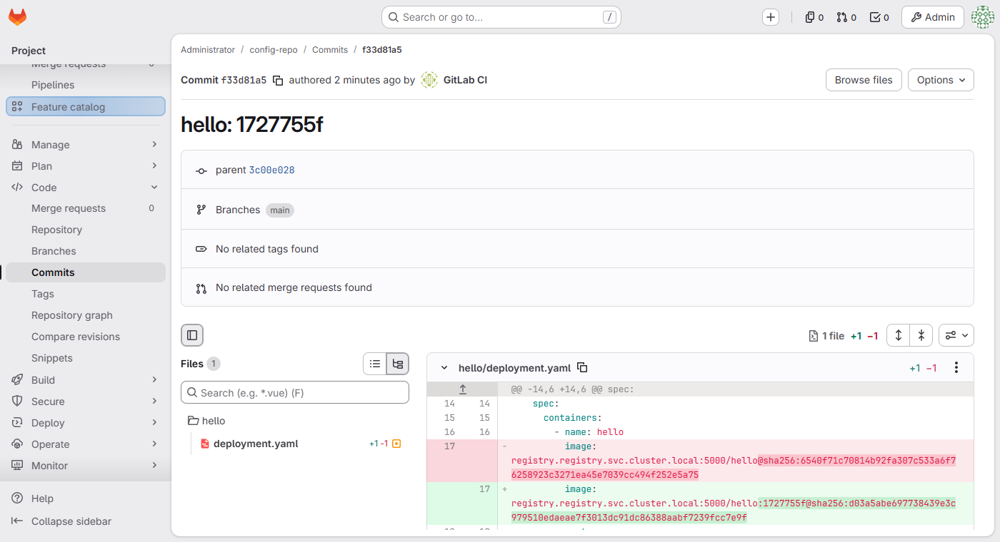

История config-repo: первый коммит мой, остальные делает CI:

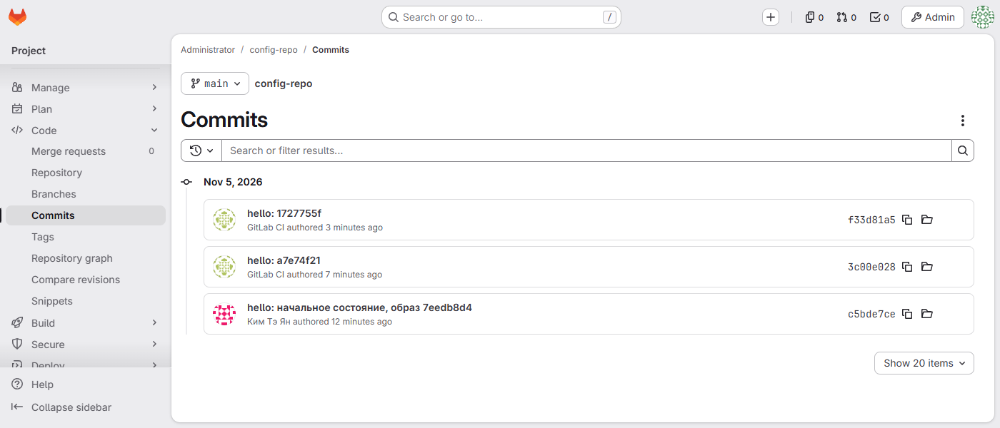

Пайплайн #6 закончился в 18:03:57, а в 18:04:18 в `demo-gitops` уже работал новый образ. GitLab в кластер не обращался, новую ревизию забрал ArgoCD. Application в состоянии Synced / Healthy на ревизии `f33d81a5`, это последний коммит config-repo:

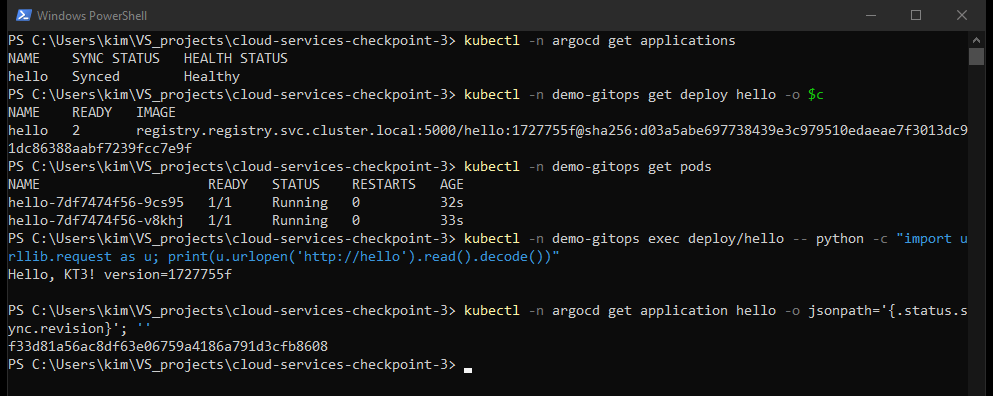

## Эксперимент 2. То же изменение при GitOps

Команда та же, что в эксперименте 1, поменялся только namespace: в 18:05:20 `kubectl -n demo-gitops set image deployment/hello hello=registry.registry.svc.cluster.local:5000/hello:477022bd`.

Когда через несколько секунд я посмотрел статус, Application уже снова был Synced. События Application показывают, что произошло (время в событиях в UTC, то есть 15:05:25Z = 18:05:25 по Москве): через 5 секунд после ручной правки ArgoCD перевёл приложение в OutOfSync, сам запустил синхронизацию на ревизию `f33d81a5` и вернул образ из config-repo. Сервис снова отвечает `version=1727755f`.

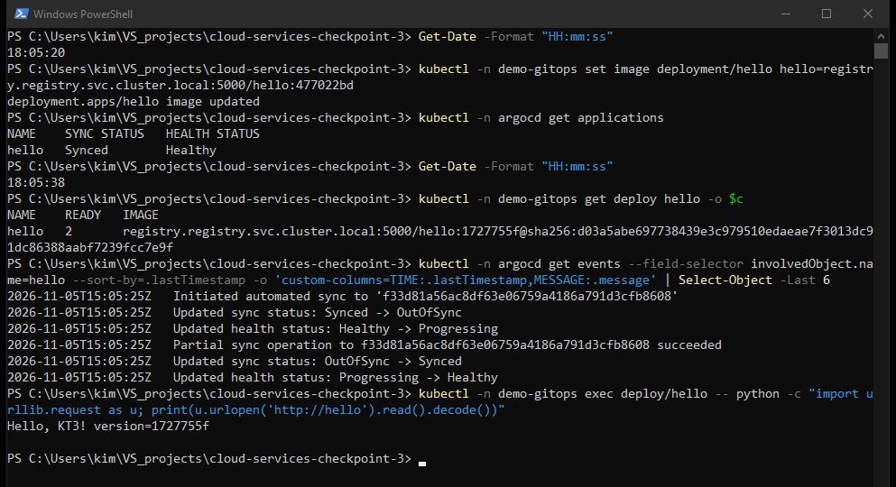

## Отчёт: push-модель и pull-модель

| | Push (часть 1) | Pull, GitOps (часть 2) |
|---|---|---|
| Кто меняет кластер | джоб CI через `kubectl` | ArgoCD изнутри кластера |
| Доступ CI к кластеру | токен ServiceAccount с правом менять Deployment в `demo-push` | нет; только запись в config-repo |
| Где описано состояние | нигде целиком: результат последнего успешного пайплайна | config-repo, образ закреплён по digest |
| Когда сверяется с кластером | только в момент деплоя | постоянно: изменения в кластере ArgoCD видит сразу, git опрашивает раз в 60 с |
| Ручная правка в кластере | осталась на 12+ минут и осталась бы дальше | обнаружена и отменена за 5 секунд |
| Откат версии | перезапустить старый пайплайн или `kubectl` руками | `git revert` в config-repo |
| Аудит изменений | логи джобов, ручные правки нигде не видны | история коммитов config-repo |
| Что сложнее | меньше компонентов, деплой виден прямо в пайплайне | второй репозиторий, контроллер, токены для него; срочную правку руками в кластер не сделать, её откатят |

Главная разница видна в экспериментах. В push-модели пайплайн отправляет изменение в кластер один раз и дальше за кластером не следит. Всё, что сделано в обход пайплайна, живёт, пока его кто-то не заметит: в эксперименте 1 за 12 минут ничего не произошло. В pull-модели ArgoCD постоянно сравнивает кластер с config-repo, поэтому та же команда в эксперименте 2 продержалась 5 секунд.

Вторая разница в доступах. В части 1 раннер должен иметь токен с правом менять Deployment, и любой, кто может изменить `.gitlab-ci.yml` или запустить джоб, получает этот доступ к кластеру. В части 2 у CI нет учётных данных кластера вообще, он может только сделать коммит в config-repo, а коммит виден в истории. Применяет изменения ArgoCD, у которого права уже внутри кластера.

Минусы у GitOps тоже есть. Нужен отдельный репозиторий и контроллер, нужны токены для него, а новая версия попадает в кластер не сразу после пайплайна, а при следующем опросе git (до 60 секунд в этой настройке; можно ускорить вебхуком). И если нужно срочно что-то поправить руками, правка проживёт секунды: её надо делать коммитом в config-repo или временно выключать selfHeal.

## SBOM и digest

syft по образу `hello:1727755f` из registry нашёл 32 пакета: пакеты alpine (apk), Python 3.13.18 и pip.

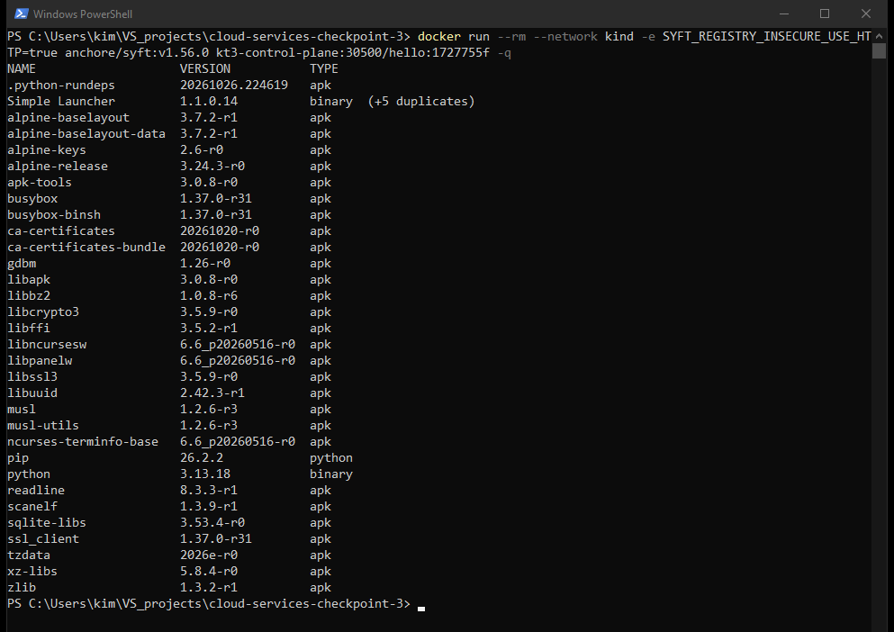

SBOM нужен, чтобы при новой уязвимости в какой-нибудь библиотеке за минуты найти все образы, где она есть, а не пересобирать и проверять всё подряд. В реальном пайплайне syft запускают после сборки и сохраняют SBOM рядом с образом, а сканер сверяет его с базой уязвимостей.

В config-repo образ записан как `hello:<sha>@sha256:<digest>`. Тег `<sha>` нужен людям, чтобы по diff было понятно, какой коммит выехал. Kubernetes при наличии digest берёт образ по нему, поэтому перезапись тега в registry ничего не изменит в кластере. Digest в config-repo совпадает с тем, что отдаёт registry по этому тегу (`Docker-Content-Digest: sha256:d03a5abe...`).

## Что пошло не так

- Redis для ArgoCD в core-install берётся из `public.ecr.aws`, отсюда слои не скачиваются (таймаут CloudFront). Тот же образ `redis:8.2.3-alpine` взят с Docker Hub, это шаг в `setup.sh infra`.
- Application сначала не синхронизировался с ошибкой `Application referencing project default which does not exist`: в core-install проект `default` никто не создаёт. Отсюда `argocd/project.yaml`.
- Первый коммит части 2 упал ещё до создания джобов: в `.gitlab-ci.yml` были строки вида `sed -i "s|image: .*|..."`, и YAML прочитал `: ` внутри как ключ. Проверил через CI Lint API, взял строки в одинарные кавычки и закоммитил исправление (пайплайн #5). Пустую запись пайплайна #4 без джобов удалил.
- Флаг kaniko `--image-name-with-digest-file` пишет ссылку без тега (`hello@sha256:...`), из diff не видно, какой коммит выехал. В #6 заменил его на `--digest-file` и собираю ссылку `тег@digest` сам.
